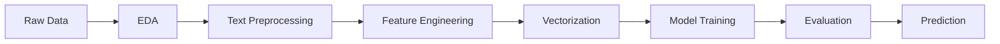

# 🔍 Quora Question Pairs — Duplicate Question Detection

<div align="center">


**Detecting whether two questions have the same meaning using NLP & Machine Learning**

[Dataset](https://www.kaggle.com/competitions/quora-question-pairs/data?select=train.csv.zip) • [Report Bug](https://github.com/YOUR-USERNAME/YOUR-REPOSITORY/issues) • [Request Feature](https://github.com/YOUR-USERNAME/YOUR-REPOSITORY/issues)

</div>

---

## 📌 Project Overview

The **Quora Question Pairs** project focuses on identifying whether two questions have the same meaning, even when they are written using different words. This is a classic **Natural Language Processing (NLP)** problem that has real-world applications in search engines, chatbots, and FAQ systems.

For example:

| Question 1 | Question 2 | Prediction |
|------------|------------|------------|
| How can I learn Python programming? | What is the best way to learn Python? | ✅ **Duplicate** |
| What is the capital of India? | How do I bake a cake? | ❌ **Not Duplicate** |

This project uses **NLP**, **text preprocessing**, **feature engineering**, and **Machine Learning** techniques to classify question pairs as duplicate or non-duplicate.

---

## 🎯 Objectives

-  Understand and explore the Quora Question Pairs dataset
-  Perform Exploratory Data Analysis (EDA) to discover patterns
-  Clean and preprocess text data
-  Extract useful features from question pairs
-  Convert text into numerical representations using Word2Vec / BoW
-  Train and evaluate Machine Learning classification models
-  Understand how NLP detects semantically similar questions

---

## 📊 Dataset

The project uses the **Quora Question Pairs** dataset, originally released for a Kaggle competition.

🔗 **Dataset Link:** [Quora Question Pairs — Kaggle](https://www.kaggle.com/competitions/quora-question-pairs/data?select=train.csv.zip)

The dataset contains pairs of questions and a target label indicating whether they are duplicates (`train.csv`).

| Column | Description |
|--------|-------------|
| `id` | Unique identifier for each question pair |
| `qid1` | Identifier of the first question |
| `qid2` | Identifier of the second question |
| `question1` | First question's text |
| `question2` | Second question's text |
| `is_duplicate` | Target label: `1` = duplicate, `0` = non-duplicate |

---

## 🛠️ Technologies Used

| Category | Technologies |
|----------|-------------|
| **Language** | Python 3.8+ |
| **Data Manipulation** | Pandas, NumPy |
| **Visualization** | Matplotlib, Seaborn |
| **NLP** | NLTK, Gensim (Word2Vec) |
| **ML / Modeling** | Scikit-learn, XGBoost |
| **Environment** | Jupyter Notebook |
| **Web App** | Streamlit *(optional)* |

---

## 🔍 Project Workflow



### 1️⃣ Exploratory Data Analysis (EDA)

- Analyze dataset dimensions and column types
- Examine duplicate vs non-duplicate question pairs
- Identify missing values and repeated questions
- Explore question lengths and word counts
- Visualize patterns and distributions

### 2️⃣ Text Preprocessing

Prepare the questions for Machine Learning by applying:

- Handling missing values
- Converting text to lowercase
- Removing or normalizing unnecessary symbols
- Tokenizing text
- Handling stop words where appropriate
- Normalizing text and expanding common abbreviations

### 3️⃣ Feature Engineering

Extract meaningful information from question pairs:

-  Number of words in each question
-  Character length of each question
-  Common words between two questions
-  Word overlap and similarity features
-  Other features to distinguish duplicate questions

### 4️⃣ Text Vectorization

Convert text into numerical features:

- **Bag of Words (BoW):** Represents text using word occurrence counts
- **CountVectorizer:** Converts questions into sparse numerical feature matrices
- **Word2Vec:** Represents words as dense vectors capturing semantic relationships

### 5️⃣ Model Training

Models explored in this project:

-  Random Forest Classifier
-  XGBoost Classifier
-  Ensemble Learning
-  Logistic Regression Classification
-  Support Vector Machine (SVM)
-  K-Nearest Neighbors (KNN)
-  Naive Bayes Classifier

### 6️⃣ Model Evaluation

Evaluate model performance using:

-  Accuracy
-  Precision
-  Recall
-  F1-score
-  Confusion Matrix

---

## 📁 Repository Structure

```
quora-question-pairs/
│
├── notebooks/
│   ├── initial_EDA.ipynb
│   ├── only-bow.ipynb
│   ├── bow-with-basic-features.ipynb
│   └── bow-with-preprocessing-and-advanced-features.ipynb
│
├── streamlit-app/
│   └── app.py
│
├── images/
│   └── (screenshots and plots)
│
├── requirements.txt
├── .gitignore
├── LICENSE
└── README.md
```

> ⚠️ **Note:** Update this structure to match your actual repository files.

---

## ⚙️ Installation and Setup

### Prerequisites

- Python 3.8 or higher
- pip
- Git


### 2️⃣ Create a virtual environment (recommended)

**Windows:**
```bash
python -m venv venv
venv\Scripts\activate
```

**macOS / Linux:**
```bash
python3 -m venv venv
source venv/bin/activate
```

### 3️⃣ Install the required libraries

```bash
pip install -r requirements.txt
```

**Or install manually:**

```bash
pip install pandas numpy matplotlib seaborn scikit-learn nltk xgboost jupyter streamlit gensim
```

### 4️⃣ Download the dataset

Download the Quora Question Pairs dataset from [Kaggle](https://www.kaggle.com/competitions/quora-question-pairs/data?select=train.csv.zip) and place `train.csv` in the project root directory.

### 5️⃣ Run Jupyter Notebook

```bash
jupyter notebook
```

Open any notebook and execute the cells in order.

### 6️⃣ Run the Streamlit App (optional)

```bash
cd streamlit-app
streamlit run app.py
```

Replace `app.py` with the actual app filename if it differs.

---

##  Expected Outcome

The project demonstrates how **NLP** and **Machine Learning** can be applied to a real-world text classification problem.

The trained model can predict whether a pair of questions is **likely to have the same meaning**. Actual performance depends on:

-  Preprocessing pipeline
-  Feature engineering
-  Model configuration
-  Evaluation method

---

##  Future Improvements

- [ ] Experiment with **TF-IDF** and advanced text representations
- [ ] Improve semantic similarity using **Word2Vec** or **sentence embeddings** (BERT)
- [ ] Explore **Logistic Regression**, **SVM**, and **gradient boosting**
- [ ] Tune hyperparameters using **cross-validation** and **GridSearchCV**
- [ ] Compare models using precision, recall, and F1-score
- [ ] Build an improved **Streamlit interface** for interactive predictions
- [ ] Explore deep learning — **Siamese networks** and **transformer-based models**

---

##  Contributing

Contributions are welcome! Here's how:

1. Fork the repository
2. Create your feature branch (`git checkout -b feature/AmazingFeature`)
3. Commit your changes (`git commit -m 'Add some AmazingFeature'`)
4. Push to the branch (`git push origin feature/AmazingFeature`)
5. Open a Pull Request

---

##  References

- Dataset: [Kaggle — Quora Question Pairs](https://www.kaggle.com/c/quora-question-pairs)
- Scikit-learn: [https://scikit-learn.org/stable/](https://scikit-learn.org/stable/)
- NLTK: [https://www.nltk.org/](https://www.nltk.org/)
- XGBoost: [https://xgboost.readthedocs.io/](https://xgboost.readthedocs.io/)
- Gensim (Word2Vec): [https://radimrehurek.com/gensim/](https://radimrehurek.com/gensim/)

---

##  License

This project is licensed under the **MIT License** — see the [LICENSE](LICENSE) file for details.

---

##  Author

**Your Name**
- GitHub: [@YOUR-USERNAME] Ambreesh 

---

<div align="center">

 **If you found this project helpful, please give it a star!** 

Made with  and Python

</div>
